# 思而行（SiErXing）· 目标规划助手

> **说清目标与现状 → AI 反复确认 → 拆成可执行路径 → 边做边调。**
> 一个本地运行、零依赖、可接入任意 AI 的目标规划应用。

- 产品名：**思而行**　·　项目目录名：**SiErXing**（英文，避免路径中文带来的兼容问题）
- 开源协议：**MIT**（可自由使用与商用、不强制开源你的修改，**但请保留作者署名**） · 作者：**sierxing** · 仓库：https://atomgit.com/sierxing/SiErXing

思而行不是"帮你把任务列出来"的工具，而是一个**会先问清楚、再动手规划**的助手：
它先用问卷了解你的真实情况与真实水平（含客观自测题），你不清楚的地方还能逐题深挖追问，
把情况问透之后才生成「阶段 → 小目标 → 任务」的可执行路径，并且**随时可以继续改**。

它不是给某一个职业定制的：转行就业、学一门技能、考研考证、做出作品、养成习惯……
任何可以拆解的目标都能用。

---

## 🚀 30 秒上手

> ⚠️ **只复制代码块里的内容**。下面的中文说明、表格都是文档文字，粘到终端会报 `is not recognized as an internal or external command`。

### ① 一条命令安装（Linux / macOS）

```bash
git clone --depth 1 https://atomgit.com/sierxing/SiErXing.git ~/SiErXing && bash ~/SiErXing/install.sh
```

**Windows**（PowerShell，**整行复制**）：

```powershell
git clone --depth 1 https://atomgit.com/sierxing/SiErXing.git "$env:USERPROFILE\SiErXing"; & "$env:USERPROFILE\SiErXing\install.bat"
```

想装到**其它盘/目录**（把 `D:\SiErXing` 换成你要的路径，整行复制）：

```powershell
$d="D:\SiErXing"; git clone --depth 1 https://atomgit.com/sierxing/SiErXing.git $d; & "$d\install.bat"
```

> 已经下载/解压了 ZIP？直接在该目录运行 `install.bat` 即可；也可以 `install.bat D:\SiErXing` 指定安装目录（会复制过去）。
> 安装脚本会**自动定位真实的桌面目录**（兼容 OneDrive 重定向），桌面图标一定能出现；终端命令 `sierxing` 装在 `%LOCALAPPDATA%\SiErXing`。

> 没有 git？打开 <https://atomgit.com/sierxing/SiErXing> 下载 ZIP → 解压 → 运行 `install.sh`（macOS/Linux）或 `install.bat`（Windows）。
> 只需要 **Node.js ≥ 22.5**（推荐 24 LTS），**不需要 npm install**（零第三方依赖）。

安装脚本会自动：检查 Node → 启动服务 → **创建桌面图标** → **创建终端命令 `sierxing`** → 询问**开机自启** → 打开浏览器。

### ② 或者：把这段提示词丢给你的 AI 助手，让它帮你装

```text
请帮我在本机部署并启动「思而行 SiErXing」——一个本地运行的目标规划助手（零第三方依赖，只需要 Node.js）。

步骤：
1. 检查 Node.js 版本是否 ≥ 22.5；不足则告诉我如何安装（推荐 Node 24 LTS）。
2. 克隆并安装：
   git clone --depth 1 https://atomgit.com/sierxing/SiErXing.git ~/SiErXing
   bash ~/SiErXing/install.sh        # Windows 用 install.bat
   （脚本会启动服务、创建桌面图标与终端命令 sierxing，并询问是否开机自启）
3. 验证服务：curl http://localhost:3213/api/health 应返回 {"ok":true}；若端口被占用，改用 PORT=其他端口 启动。
4. 按我的意愿处理开机自启（开/关都行）：
   curl -s -X POST http://localhost:3213/api/service/autostart -H 'Content-Type: application/json' -d '{"enabled":true}'
5. 告诉我：访问地址（默认 http://localhost:3213）、桌面图标名（思而行）、终端命令（sierxing）。
6. 提醒我必须在页面「设置」里配置 AI 才能使用（见下一步）。

注意：不要 npm install，不要改动系统级配置；所有安装动作只写用户目录，无需管理员权限。
```

### ③ 配一个 AI（唯一必须做的事）

打开 <http://localhost:3213> → 左侧栏 **⚙ 设置** → 选择接入方式 → 点 **测试连接**：

| 方式 | 需要填什么 |
| --- | --- |
| **OpenAI 兼容接口**（推荐） | 点预设一键填好（DeepSeek / 通义千问 / Kimi / 智谱 / OpenAI…），再填 API 密钥 |
| **本地 Ollama**（离线免费） | 地址 `http://localhost:11434/v1`，模型如 `qwen2.5:14b`，密钥随便填 |
| **opencode CLI**（已装可选） | 模型填 `provider/model`（如 `opencode-go/deepseek-v4-flash`），地址密钥留空 |

配好后就能用了：**新建目标 → 回答问卷（可逐题深挖）→ 加约束 → 确认骨架 → 细化任务 → 开始执行**。
第一次打开会有 5 步使用引导；桌面图标与开机自启都可在「设置 → 服务与启动」里随时开关。

> 下面是界面截图与完整功能说明 —— **只想快速用起来的话，看到这里就够了。**

---

## 界面截图

| 首次使用引导（含界面演示动画）           | 目标页：路线图 · 约束 · 下一步        |
| ---------------------------------------- | --------------------------------------- |
| 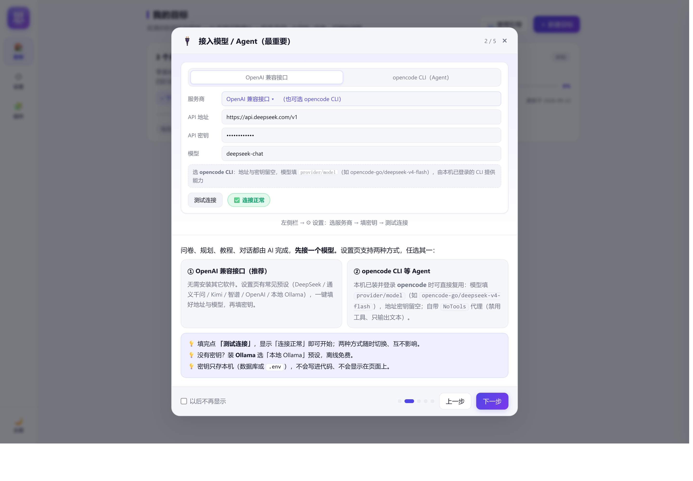 | 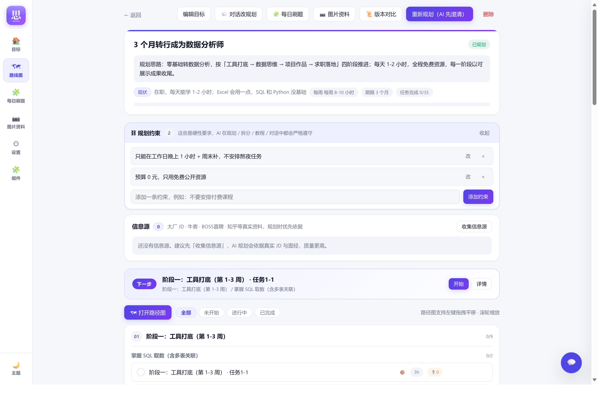 |

| 全屏导图                             | 对话改规划（可直接改路线图）          |
| ------------------------------------ | ------------------------------------- |
| 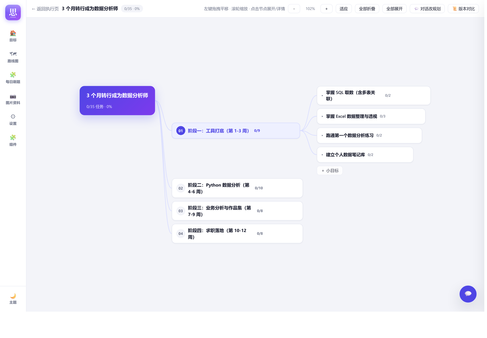 | 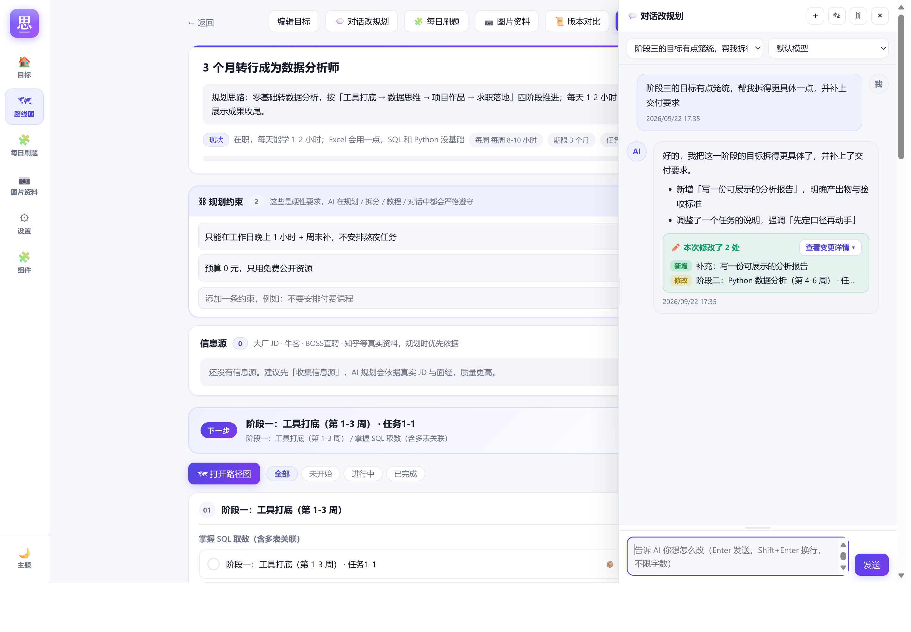 |

| 规划前问卷（含水平自测，可逐题深挖）           | 新建目标（组件选择器）                        |
| ---------------------------------------------- | --------------------------------------------- |
| 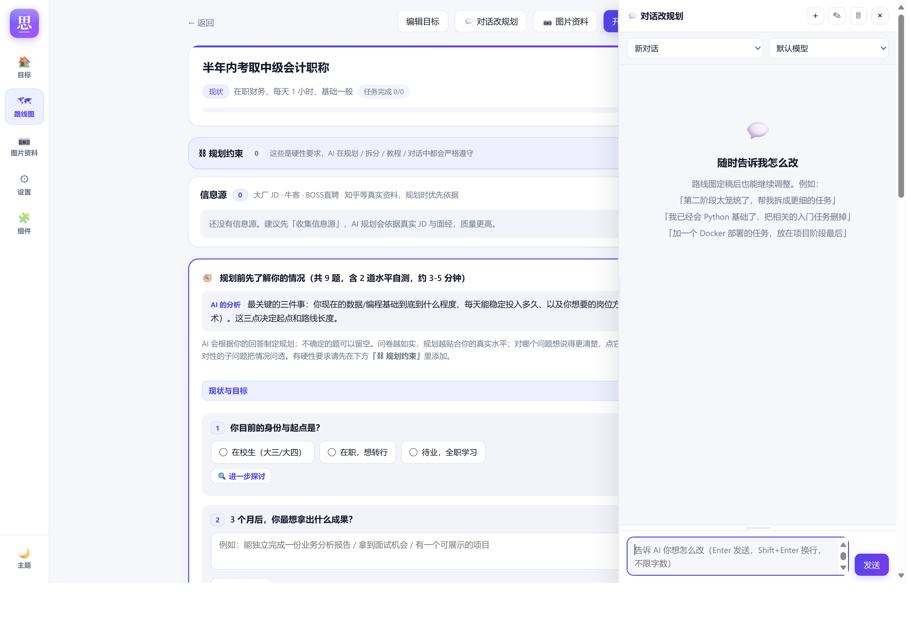 | 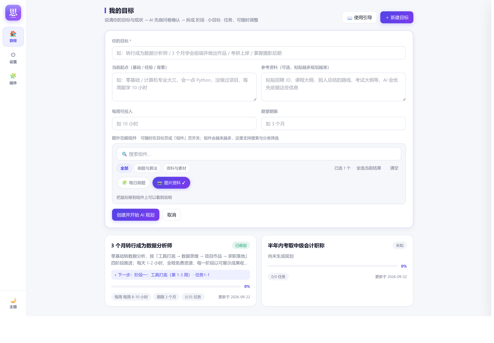 |

| 组件中心（开关 / 分类管理 / 换肤）          | 设置（接入模型 / 服务与启动）             |
| ------------------------------------------- | ----------------------------------------- |
| 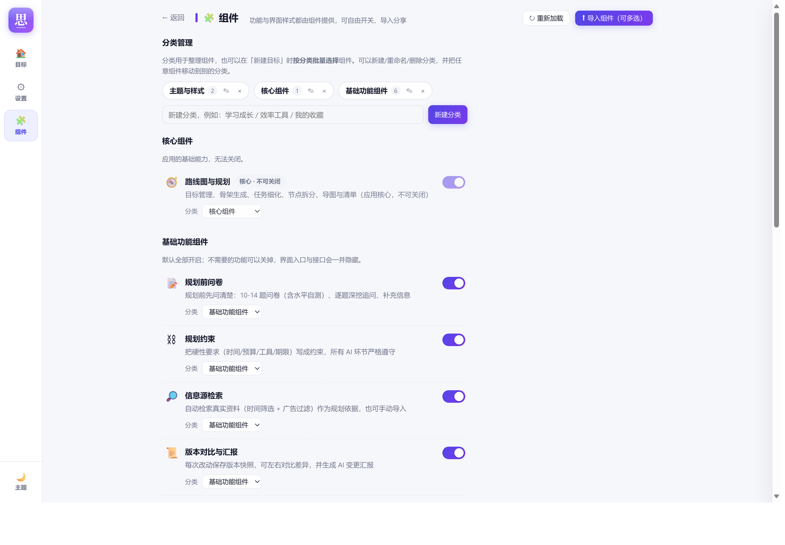 | 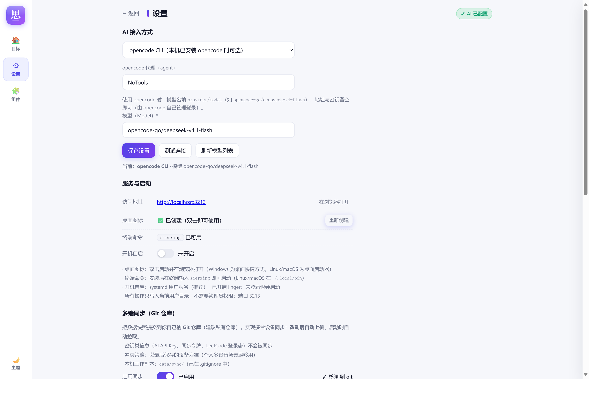 |

| 批量导入组件（可多选 + 统一分类）       | 每日刷题（扩展组件）                   |
| --------------------------------------- | -------------------------------------- |
| 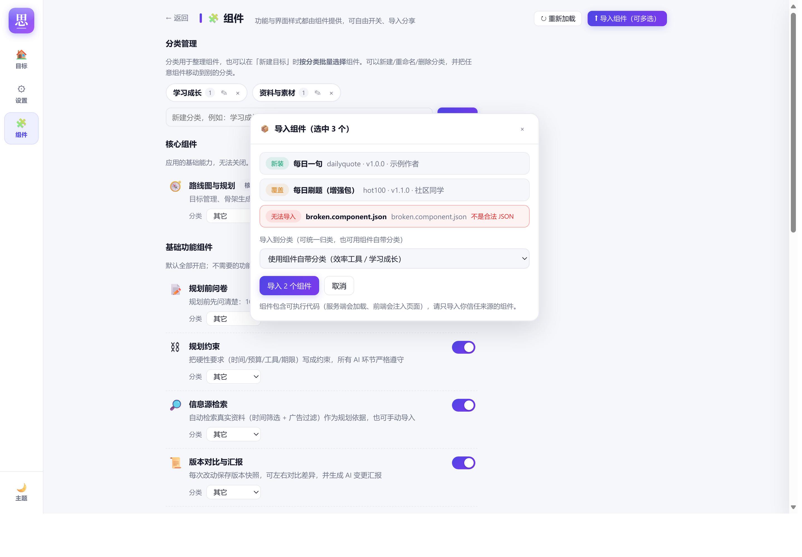 | 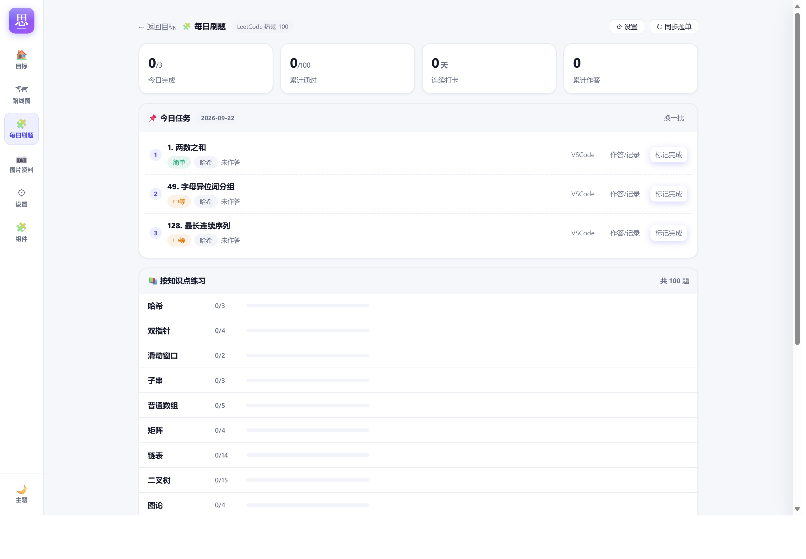 |

| 左栏组件模块（收起：不占地方）                | 左栏组件模块（展开：分组 + 常用置顶 + 拖拽）    |
| --------------------------------------------- | ----------------------------------------------- |
|  |  |

| 版本对比（左旧右新，彩色标注）        | 学习教程（真正学会，含练习与自测）        |
| ------------------------------------- | ----------------------------------------- |
| 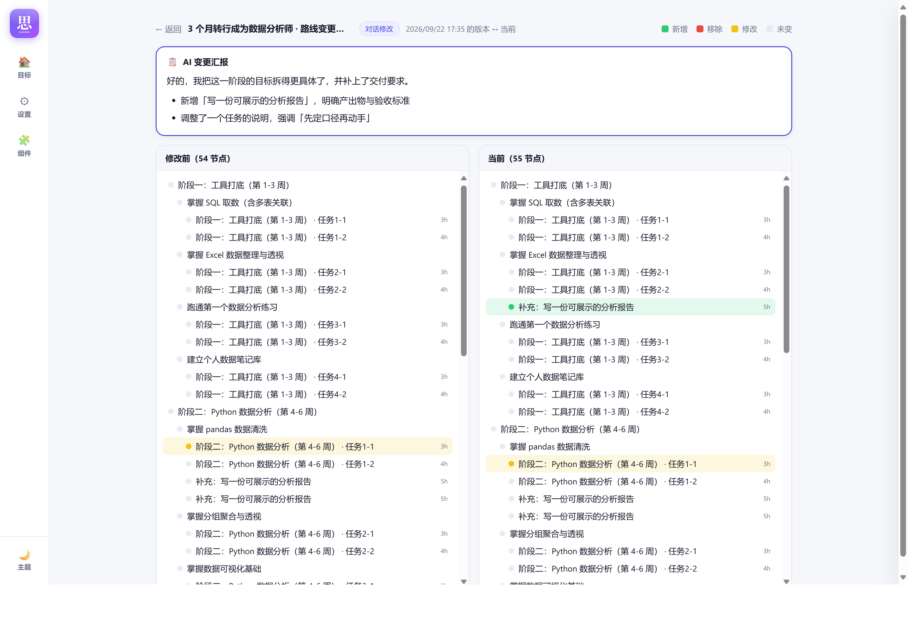 | 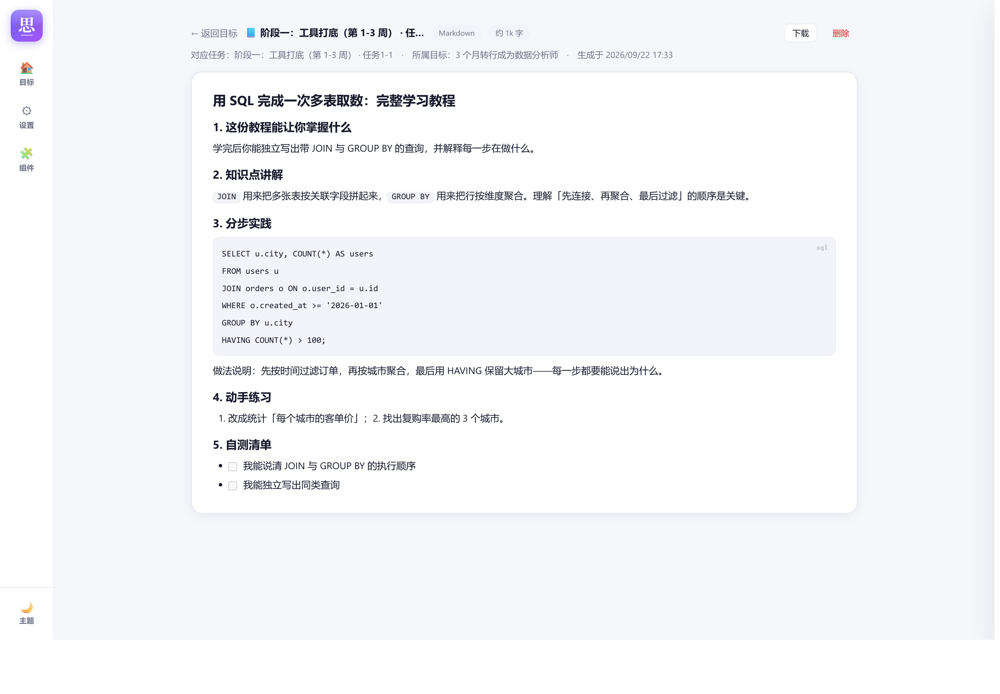 |

| 多端同步（引导内直接填仓库与账号）           | 多端同步（设置页：自动上传 / 自动拉取）      |
| -------------------------------------------- | -------------------------------------------- |
| 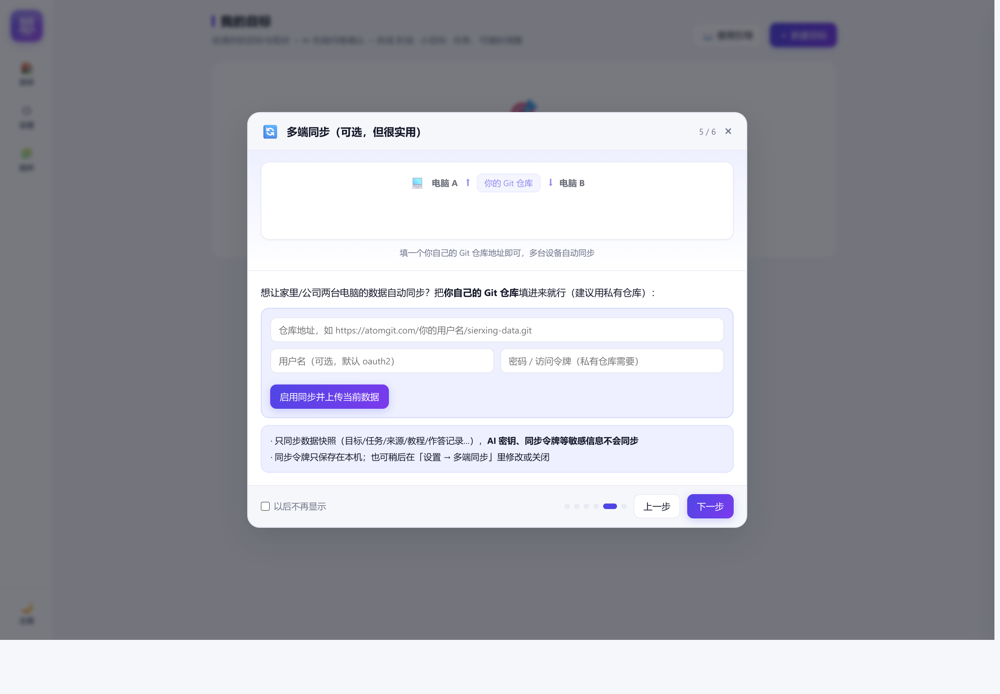 |  |

> 更多截图见 [`docs/screenshots/`](docs/screenshots/)：每日刷题、引导各步等。

---

## 目录

- [🚀 30 秒上手](#-30-秒上手)
- [一、核心特色](#一核心特色)
- [二、功能一览](#二功能一览)
- [三、快速开始](#三快速开始)
- [四、配置 AI（不需要 opencode）](#四配置-ai不需要-opencode)
- [五、使用指南](#五使用指南)
- [六、数据、备份与隐私](#六数据备份与隐私)
- [七、目录结构](#七目录结构)
- [八、常见问题](#八常见问题)
- [九、插件开发（功能扩展）](#九插件开发功能扩展)
- [十、许可](#十许可)

---

## 一、核心特色

| 特色                           | 说明                                                                                                                                                                                                          |
| ------------------------------ | ------------------------------------------------------------------------------------------------------------------------------------------------------------------------------------------------------------- |
| **先确认，再规划**       | 规划前必出问卷（10-14 题，分 6 个板块），含**客观自测题**校准真实水平；每一步规划（骨架/拆分/细化）AI 仍可继续追问                                                                                      |
| **逐题「进一步探讨」**   | 任何问题都能点开深挖：AI 针对该问题追加 2-5 个更细的子问题，最多 3 层；还能自己**补充额外信息**供 AI 参考                                                                                               |
| **手动约束**             | 把硬性要求（时间、预算、工具、期限、禁忌）写成「⛓ 规划约束」，规划 / 拆分 / 教程 / 对话全程严格遵守；也能在对话里直接加约束                                                                                  |
| **可插拔 AI**            | **不强制依赖任何 CLI**：默认走任意 **OpenAI 兼容接口**（OpenAI / DeepSeek / 通义千问 / Kimi / GLM / 硅基流动 / OpenRouter / Ollama / LM Studio / vLLM …），也**可选**使用本机 opencode CLI |
| **本地优先**             | 零第三方依赖（只用 Node 内置模块 + SQLite），数据全部保存在你自己的电脑上，不出本机（除了调用你配置的 AI 接口）                                                                                               |
| **全过程可视化**         | 全屏导图、执行清单、进度统计；每次改动都有**版本快照**与「左旧右新」彩色对比图 + AI 变更汇报                                                                                                            |
| **对话式改规划**         | 右侧可拖拽宽度的对话侧边栏，随时用自然语言让 AI 改路线图，改了什么一目了然（彩色操作清单 + 就地展开的对比图）                                                                                                 |
| **按需生成教程**         | 右键任意任务点 → 生成「真正学会」的完整教程（HTML 或 Markdown），讲原理、分步实践、练习与自测清单                                                                                                            |
| **资料图片识别**         | 粘贴**任何图片**（JD / 大纲 / 教材 / 笔记 / 表格 / 截图…），视觉模型提炼成结构化资料，自动导入资料库并优先参与规划                                                                                                                                       |
| **多端同步**             | 填一个你自己的 Git 仓库地址，数据快照自动上传、启动时自动拉取，多台电脑共享同一份进度；**AI 密钥、同步令牌等敏感信息绝不同步**                                                                            |
| **一切皆组件**           | 功能与**界面样式**都是组件：左侧栏「🧩 组件」页可逐个开关（基础功能默认开启、可关掉），也可**导入/导出组件包**互相分享；主题皮肤同样是组件（覆盖设计变量即可换肤）                                |
| **每日刷题（内置插件）** | 针对编程类目标：LeetCode 热题 100（按 17 个知识点分组），每日任务、完整题面、作答记录（代码 / 笔记 / 用时 / 次数）                                                                                            |

---

## 二、功能一览

### 1. 目标与规划

- **新建目标**：填写目标、当前起点、参考资料（可粘贴 JD / 大纲）、每周可投入、期望期限
- **规划前问卷**：AI 生成 10-14 题，按「现状与目标 / 真实水平 / 水平自测 / 时间与节奏 / 偏好与资源 / 风险与心态」组织
  - `单选`、`多选`、`简答`、`自测题（客观题，答完立即显示对错与解析）`
  - **进一步探讨**：逐题深挖子问题（最多 3 层），并支持**自己补充额外信息**
  - 所有问答（含追问、补充信息）都会进入规划上下文
- **规划约束**：目标页「⛓ 规划约束」卡片可增/改/删；约束会被注入到所有 AI 环节，标注为最高优先级
- **三步规划**（可随时中断、继续）
  1. `生成骨架`：仅 阶段 + 小目标（每阶段 3-4 个小目标）
  2. `确认或提意见`：不满意可直接写意见，AI 按意见重排骨架（可多轮）
  3. `细化任务`：逐阶段生成任务（**每阶段任务总数 ≤ 10**；每个节点直接子任务 ≤ 10）
- **AI 追问机制**：规划途中若信息不足，AI 会先提问、不硬猜；回答问题后继续（最多 3 轮）
- **信息源**：内置检索（百度为主、必应为备，含时间筛选与广告过滤）与发布时间校验；也可手动粘贴、导入图片

### 2. 可视化与执行

- **全屏导图**：左键拖拽平移、滚轮缩放、适应屏幕、全展开/折叠；多级子任务递归展示
- **执行清单**：按阶段分组，状态（未开始 / 进行中 / 已完成）、子任务进度、下一步推荐
- **进度统计**：按最细颗粒（叶子节点）统计完成度
- **节点操作**：右键菜单（AI 深度拆分 / 提意见调整划分 / 生成学习教程 / 查看信息源 / 状态切换 / 编辑 / 删除）

### 3. 版本对比与汇报

- 每次改动（重新规划、调整骨架、细化任务、节点拆分、手动增删改、对话修改）自动存版本快照
- **对比页**：左「修改前」右「当前」两列彩色树（🟢新增 / 🔴移除 / 🟡修改 / ⚪未变）
- **AI 变更汇报**：每次改完给出简要说明（改了什么、为什么、下一步建议）
- 对话中的每次修改：彩色操作清单 + 可展开的「该次修改前后」精确对比

### 4. 对话式改规划（右侧侧边栏）

- 右下角悬浮按钮随时呼出/隐藏（状态记忆），**宽度与输入框高度可拖拽调节**
- 多会话管理：新建 / 重命名 / 删除 / 切换，每个会话独立保存模型
- 模型可选（从你的接口拉取模型列表）
- 流式输出 + 「思考中」状态与计时；Markdown 实时渲染
- AI 能**直接修改路线图**：新增 / 修改 / 删除 / 移动节点、改状态、加约束

### 5. 学习教程

- 右键任务点 → 生成完整教程，可选 **HTML**（图文排版，含目录/提示框/清单样式）或 **Markdown**
- 教程内容以「真正掌握」为目标：能力清单、前置知识、原理讲解、分步实践（做什么/为什么/怎么做/自检/排错）、动手练习、掌握自测清单、验收对应、延伸学习
- 生成后可在线阅读、下载（.html / .md）、删除；节点面板里可随时回看历史教程
- **📑 左侧目录**：按教程章节自动生成，点击跳转、滚动高亮当前章节、显示阅读进度并记住位置；可折叠、可拖动调宽
- **✍️ 学习笔记**（扩展组件，可开关）：教程页右侧栏，在对应节点记 Markdown 笔记，一边看一边记；单个框体（平时直接看渲染效果，点编辑修改、保存生效，双击正文也可进入编辑），可折叠、可拖动调宽，随多端同步
- **🔖 教程书签**（扩展组件，可开关/导出/卸载）：在教程里按章节打标签——记录读到哪、标重点/待复习，点击跳回对应章节；书签随多端同步
- **⬆ 导入教程**：节点面板里可把写好的 `.md` / `.html` 文件直接导入为该节点的教程（标题默认用文件名）

### 6. 图片资料（内置基础组件，任何图片都能识别）

- 粘贴（Ctrl+V）/ 拖拽 / 选择文件上传截图，**不限于 JD**：课程大纲、教材、笔记、表格、文章、代码截图都可以
- 视觉模型先判断图片类型，再提炼结构化信息：
  - **JD**：岗位 / 公司 / 地点 / 薪资 / 职责 / 要求 / 技能关键词 / 硬性条件 / **招聘方最看重项**
  - **大纲 · 教材 · 笔记**：章节与知识模块 / 核心概念 / 学习目标 / 重点难点 / 前置知识
  - **表格 · 其他**：按原结构归纳条目与关键事实
- 提炼结果自动**导入资料库**（资料源）并优先参与规划；可查看原图、展开详情、删除
- **重新识别会原地更新同一条资料源**（改好视觉模型后点「🔄 重试识别」，信息源库跟着变新，不会重复堆积）
- **一键导出 / 导入（纯文字）**：点「⬇ 导出全部（文字）」得到 `*.sources.json`（含提炼出的结构化内容与原文，不含图片），发给别人后对方在图片资料页点「⬆ 导入资料」即可**一键进自己的信息源库**（重复内容自动跳过）
- **图片资料在规划里是最高优先级**：用户自己提供的资料（识别的图片 / 导入的资料）会单独成块标注「★最高优先级」——硬性条件必须原样满足、规划与之高度对齐、与网络检索冲突时以用户资料为准

### 7. 组件系统（功能 + 界面样式都可替换）

**左侧栏「🧩 组件」页**（在「设置」下方）集中管理所有组件：

| 分区           | 说明                                                                                                                                     |
| -------------- | ---------------------------------------------------------------------------------------------------------------------------------------- |
| 核心组件       | 路线图与规划（应用基础，不可关闭）                                                                                                       |
| 基础功能组件   | 规划前问卷 / 规划约束 / 信息源检索 / 版本对比与汇报 / 对话改规划 / 学习教程 / 图片资料 ——**默认开启，可一键关掉**（界面入口与接口一并隐藏） |
| 主题与界面样式 | 主题组件通过覆盖设计变量换肤，**同时只生效一个**；内置「碳黑」「宣纸」两个示例                                                     |
| 扩展组件       | 每日刷题、教程书签、学习笔记等独立文件组件：可**按目标启用**、可**导出分享**、可卸载；可**移动到自定义分类**                     |
| 组件展示       | 按**分类**分模块展示，组件以**卡片**形式放在所属分类模块里；改某个组件的分类，卡片会真正搬到对应模块 |
| 分类管理       | 自建 / 重命名 / 删除分类；分类会体现在新建目标的选择器里，支持**按分类批量选择**                                                   |
| 批量导入       | 一次选多个`*.component.json`，统一归类到指定分类；导入前显示每个包的状态与失败原因                                                     |

- **左栏「📦 组件」模块**：本目标启用的**扩展组件**收在一个可展开的模块里（目标页「🧩 组件」按钮可按目标开关，未启用的不会出现）（不再平铺在左栏），**展开后保持展开**直到手动收起；组件**按分类分组**，可**拖拽**或**右键**加入「⭐ 常用」置顶，常用项还能拖动排序（像好友列表那样）
- **组件分类可自管**：在「组件」页可**新建 / 重命名 / 删除分类**，并把任意组件**移动到指定分类**（卡片会搬到对应分类模块；自定义分类优先于插件自带分类）
- **新建目标时的组件选择器**：芯片式多选 + **搜索** + **分类筛选（带数量）** + 「全选当前结果」+「**批量选择本类**」（按分类一键勾选整类组件），按「未来上百个组件」的规模设计；每个组件悬停可看说明，右上角显示已选数量
- **分享组件**：点「导出」得到 `*.component.json`（含服务端代码 + 前端代码 + 样式），对方在「组件」页「导入组件」即可安装并立即生效（`examples/dailyquote.component.json` 是一个完整示例）
- **批量导入**：导入时**可一次选择多个组件包**（单个也支持），弹窗会逐个列出「新装 / 覆盖 / 无法导入」及原因，并可**统一指定导入到哪个分类**（或沿用组件自带分类，也能在弹窗里新建分类）
- **组件能力**：服务端（建表 / 接口 / 目标删除清理 / 导出导入钩子）+ 前端（左侧栏入口 / 页面路由 / 渲染）+ 样式（自带 CSS）
- 细节见 [九、插件开发（功能扩展）](#九插件开发功能扩展)

### 8. 资源库（资料汇总 · 按规划归类 · 一键导出）

- 左侧栏 **📚 资源库**：集中查看这个目标的全部资料与提炼汇总
  - **按规划归类**：每个阶段自动关联「该阶段节点标注的依据 + 相关提炼汇总 + 相关资料」（关键词匹配）
  - **主题汇总（MD）**：AI 通读全部资料后整理的多篇主题 Markdown，可展开阅读
  - **全部资料**：按类型（JD / 面经 / 大纲 …）分组，可展开看正文与原文链接
  - **一键导出**：`⬇ 一键导出（Markdown）` 得到整库 Markdown（提炼汇总 + 全部资料），发给别人即可分享
  - **导入资料**：对方拿到 `*.sources.json` 可一键导入自己的资料库（自动去重）
- 节点右键 →「📚 资料与提炼汇总」：查看该节点规划时依据的**资料库正文**与该节点的**相关提炼汇总**

### 9. 收集信息源（可随时停止）

- 「信息源」面板一键收集：从搜索引擎抓取真实 JD / 面经 / 学习路线，AI 规划时优先依据
- **随时可停**：收集中或 AI 生成中都可以点 **「⏹ 停止」**——立即中断（服务端同步终止上游 AI 请求，不再继续消耗额度），**已收集 / 已生成的内容会保留**，不会留下失败状态，可随时重新开始或继续
- 按错了也不怕：停止后目标回到可继续的状态，重新点「开始 AI 规划」或「继续细化任务」即可

### 10. 多端同步（Git 仓库）

- **配置**：设置页「多端同步」填仓库地址（建议私有仓库）+ 分支 + 用户名/访问令牌；引导第 5 步也能直接填
- **自动上传**：任何改动后 20 秒自动提交并推送（快照文件 `sierxing-sync.json`）
- **自动拉取**：每次打开程序时从仓库拉取，比本地新就自动导入（页面数据随之更新）
- **手动**：设置页可「立即上传 / 立即拉取 / 保存并测试连接」
- **安全**：只同步数据（目标 / 节点 / 来源 / 教程 / 版本 / 对话 / 作答记录 / 组件与分类等设置），**AI API Key、同步令牌、LeetCode 登录态一律不同步**；令牌只存本机
- **冲突策略**：以最后保存的设备为准（个人多设备场景足够；每次导入前会自动本地备份）
- 本机工作副本在 `data/sync/`（已在 .gitignore 中）

### 11. 服务与启动

- **桌面图标**：一键创建（Windows 快捷方式 / Linux·macOS 桌面启动器），**图标与浏览器标签页同款**（渐变底白色「思」），双击启动并在浏览器打开
- **终端命令**：`sierxing`（Linux/macOS 位于 `~/.local/bin`）
- **开机自启**：安装时可选择，之后随时在「设置 → 服务与启动」里开关
  - Linux：systemd 用户服务（推荐；端口被占用时会自动重试，退出后自动接管）；无 systemd 时退回 XDG 自启动
  - Windows：启动文件夹快捷方式；macOS：LaunchAgent
- 设置页可查看访问地址、复制启动方式、查看当前机制与提示

### 12. 每日刷题（内置插件，编程类目标适用）

- 从 leetcode.cn 拉取「热题 100」，按 **17 个知识点** 分组（哈希 / 双指针 / 滑动窗口 / 子串 / 普通数组 / 矩阵 / 链表 / 二叉树 / 图论 / 回溯 / 二分查找 / 栈 / 堆 / 贪心 / 动态规划 / 多维动态规划 / 技巧）
- 每日任务（题量 1-10 可调，自动跳过已通过）、换一批、手动勾选
- 题目详情：完整中文题面（从 leetcode.cn 抓取并缓存，**Markdown 与 HTML 题面都能正确渲染**，代码块带语言角标）、难度、标签
- **VSCode 作答**：一键在作答目录生成 `题号.题名.py`（带 LeetCode 插件识别头 `@lc app=leetcode.cn id=...`），并在 VSCode 打开，可直接用插件 Test / Submit
- 作答记录：日期、是否通过、语言、用时、**代码**、**笔记**；支持「从 VSCode 文件读取代码」；统计累计通过 / 连续打卡 / 活跃天数

> 该模块需要本机有 VSCode LeetCode 插件的登录态文件（默认 `~/.lc/leetcode.cn/user.json`），否则会提示未配置。非编程目标可以完全不用这个模块。

---

### 13. 更新与升级（自动检查，一键更新）

- **启动时自动检查**远端是否有新提交（后台进行，不拖慢启动；网络不通时静默跳过）
- 有新版本时右下角弹出提示：**落后几个提交 · 最新提交说明**，可选
  - **更新内容**：展开看这次更新包含哪些提交
  - **立即更新**：一键拉取 → 自动重启应用 → 页面自动刷新
  - **稍后**（6 小时内不再打扰）/ **跳过此版本**（下次有新版本还会提醒）
- **设置 → 版本与更新**：随时手动「检查更新」，查看当前版本、上次检查时间与提交列表
- 更新策略是 `git pull --ff-only`：**本地有改动会先自动 stash**，更新后再恢复；有冲突会明确告知并保留在 `git stash`，不会悄悄丢代码
- 只替换程序文件；**数据（目标 / 组件设置 / 密钥 / 作答记录）都在本地，不受影响**（`data/` 与仓库无关）
- 只有 `git clone` 安装的副本支持自动更新；解压安装包会提示重新 clone（数据不会丢）

---

## 三、快速开始

### 安装与启动方式（细节）

> 一键安装命令见文首 [🚀 30 秒上手](#-30-秒上手)。这里补充各种使用方式与细节。

| 使用方式 | 操作 |
| --- | --- |
| 一键安装 | 见文首：`git clone … && bash install.sh`（Windows：`install.bat [安装目录]`，可指定任意盘） |
| 桌面图标 | 安装后双击「思而行」→ 自动启动服务并打开浏览器 |
| 终端命令 | 安装后输入 `sierxing`（已在运行时直接打开浏览器） |
| 开机自启 | 安装时选择，或随时在 **设置 → 服务与启动** 里开关 |
| 手动启动 | `./start.sh`（Windows：`start.bat`）或 `npm start` |

> 所有安装动作只写入当前用户目录（`~/.local/bin`、桌面、`~/.config/systemd/user` 等），**不需要管理员权限**。

### 环境要求

- **Node.js ≥ 22.5**（推荐 Node 24 LTS）
  - Node **23.4+ / 24** 自带 `node:sqlite`，直接启动
  - Node **22.5 ~ 23.3** 需要加 `--experimental-sqlite`（启动脚本会自动判断）
- 无需安装任何 npm 依赖（项目零第三方依赖）

### 启动

```bash
cd SiErXing        # 进入项目目录（下载/解压后的目录名）
```

**方式一：一键脚本（推荐）**

- Linux / macOS：
  ```bash
  ./start.sh
  ```
- Windows：双击 `start.bat`
- 或使用 npm：
  ```bash
  npm start            # Node 23.4+
  npm run start:sqlite # Node 22.5 ~ 23.3
  ```

**方式二：手动命令**

```bash
node --no-warnings server/server.js
# 旧版 Node 追加 --experimental-sqlite
```

启动后打开 [http://localhost:3213](http://localhost:3213)（端口可用 `PORT` 环境变量修改）。

### 第一次使用

1. 打开右上角 **设置**，填入 AI 接口（见下一节），点「测试连接」确认可用
2. 回首页点 **＋ 新建目标**，填写目标与现状
3. 按提示完成问卷 → 骨架 → 确认 → 任务细化
4. 想调整功能或换肤？打开左侧栏 **🧩 组件**（在「设置」下方）：可开关基础功能、启用主题、导入/导出组件

> 首次打开会自动弹出**使用引导**（5 步，带界面演示动画）：介绍如何接入模型（OpenAI 兼容接口 **或** opencode CLI 等 Agent）、组件是什么、一条目标的完整使用流程。勾选「以后不再显示」即可关闭，之后可随时从首页「📖 使用引导」或设置页「帮助」重新查看。

---

## 四、配置 AI（不需要 opencode）

思而行的 AI 层是可插拔的，默认使用**任意 OpenAI 兼容接口**。你只需要三样东西：
**API 地址（Base URL）**、**API 密钥**、**模型名**。

### 设置方式（二选一）

**A. 网页设置（最简单）**
右上角「设置」→ AI 接入方式选 `OpenAI 兼容接口` → 填地址/密钥/模型 → 保存 → 点「测试连接」。

**B. 环境变量 / `.env` 文件（适合服务器部署）**
复制 `.env.example` 为 `.env` 并填写；同名环境变量会作为默认值（网页里填写的值优先）。

| 环境变量                   | 说明                                                   |
| -------------------------- | ------------------------------------------------------ |
| `PORT`                   | 服务端口（默认 3213）                                  |
| `SIERXING_PROVIDER`      | `openai`（默认）或 `opencode`                      |
| `SIERXING_API_BASE`      | OpenAI 兼容接口地址，如`https://api.deepseek.com/v1` |
| `SIERXING_API_KEY`       | API 密钥                                               |
| `SIERXING_MODEL`         | 文本模型名                                             |
| `SIERXING_VISION_MODEL`  | 视觉模型名（识别图片用，可留空 = 与文本模型相同）      |
| `SIERXING_AI_TIMEOUT_MS` | 单次请求超时（默认 300000，即 5 分钟）                 |

### 常见服务配置示例

| 服务                   | Base URL                                              | 模型示例                                          |
| ---------------------- | ----------------------------------------------------- | ------------------------------------------------- |
| OpenAI                 | `https://api.openai.com/v1`                         | `gpt-4o-mini`、`gpt-4o`                       |
| DeepSeek               | `https://api.deepseek.com/v1`                       | `deepseek-chat`、`deepseek-reasoner`          |
| 阿里云百炼（通义千问） | `https://dashscope.aliyuncs.com/compatible-mode/v1` | `qwen-plus`、`qwen-max`；视觉 `qwen-vl-max` |
| 月之暗面 Kimi          | `https://api.moonshot.cn/v1`                        | `moonshot-v1-8k`、`kimi-k2-0905-preview`      |
| 智谱 GLM               | `https://open.bigmodel.cn/api/paas/v4`              | `glm-4-plus`；视觉 `glm-4v-plus`              |
| 硅基流动 SiliconFlow   | `https://api.siliconflow.cn/v1`                     | `deepseek-ai/DeepSeek-V3`                       |
| OpenRouter             | `https://openrouter.ai/api/v1`                      | 任意其列出的模型                                  |
| 本地 Ollama            | `http://localhost:11434/v1`                         | `qwen2.5:14b`（密钥随便填，如 `ollama`）      |
| LM Studio              | `http://localhost:1234/v1`                          | 界面里加载的模型名                                |

> **地址怎么写？** 一般填到 `/v1` 即可（程序会自己拼接 `/chat/completions` 与 `/models`）。
> 也可以直接填完整地址（以 `/chat/completions` 结尾）。

### 使用 opencode CLI（可选）

如果你的电脑已经装好并登录了 [opencode](https://opencode.ai)，也可以让它来干这些活：

1. 设置 → AI 接入方式选 `opencode CLI`
2. 模型名填 `provider/model`（如 `opencode-go/deepseek-v4-flash`）
3. 代理留默认 `NoTools`：**选择 opencode 接入时程序会自动创建 `.opencode/opencode.json`**（禁用工具、只输出文本，更快更安全；已存在则不覆盖你的配置）。不用 opencode 时不会生成该目录

两种方式可以随时切换，互不影响。

### 模型能力建议

| 用途                                | 建议                                                                                        |
| ----------------------------------- | ------------------------------------------------------------------------------------------- |
| 规划 / 拆分 / 教程（长文本 + JSON） | 选择**上下文较长、指令遵循好**的模型（≥ 32k 上下文更稳）                             |
| 问卷 / 追问 / 对话                  | 任意对话模型即可                                                                            |
| 图片识别（资料图片）                 | 需要**视觉模型**（如 `qwen-vl-max`、`gpt-4o`、`glm-4v-plus`），在设置里单独填写 |

---

## 五、使用指南

### 典型流程

1. **新建目标**：写清目标（越具体越好）、现状、可投入时间，若手上有 JD / 大纲 / 笔记等图片资料可直接上传
2. **回答问卷**：如实作答；不确定的题点 **🔍 进一步探讨** 让 AI 追问；想补充情况就写在补充框里
3. **加约束**：把硬性要求写进「⛓ 规划约束」，例如「只能周末学，每周 ≤ 6 小时」「预算 0 元」
4. **生成骨架** → 不满意就写意见让它重排 → 满意后 **✓ 确认，开始细化任务**
5. **执行**：在清单里推进；点节点看详情、信息源；右键任务可 **✨ AI 深度拆分**
6. **改规划**：右下角 **💬** 打开对话侧边栏，直接说「把第二阶段拆细」「删掉已会的入门任务」；改完可点「查看变更详情」
7. **学不会？** 右键任务 → **📘 生成学习教程**，按教程一步步学（含练习与自测清单）
8. **复盘**：目标页「📜 版本对比」回看每次变化；左栏「📦 组件」→「每日刷题」（需在新建目标时勾选）做每日练习并记录
9. **扩展**：需要别的能力？左侧栏的组件都是插件，可自行新增（见「九、插件开发」）

### 关键设计说明

- **为什么任务很少？** 每个阶段任务总数 ≤ 10、每个节点直接子任务 ≤ 10。任务太多会让人压力过大、难以坚持，宁可粗一点也要"做得完"。
- **AI 会先问再规划**：任何环节只要存在会实质影响规划的不确定信息，AI 会先提问而不是替你假设。
- **约束是硬性的**：约束会出现在所有提示词的最前面，AI 若因约束做了取舍，必须在说明里讲清楚。

---

## 六、数据、备份与隐私

- **数据库**：`data/sierxing.db`（SQLite，单文件）
- **自动备份**：每次改动自动备份到 `data/backups/`（保留最近 30 份）
- **导出 / 导入**：设置页「导出全部 JSON」可导出所有目标、节点、来源、版本、教程、对话等；导入会覆盖现有数据（导入前自动备份）
- **上传图片**：保存在 `data/uploads/`
- **隐私**：所有数据只保存在本机；除调用你配置的 AI 接口外，不会上传任何内容
  - 内置信息源检索会访问百度 / 必应等公开页面（可不用：不点「收集信息源」即可）
  - LeetCode 刷题模块会读取本机插件登录态并访问 leetcode.cn（可不用）
- **API 密钥**：保存在本机数据库（或 `.env`），不会出现在前端页面（设置页只显示掩码）

---

## 七、目录结构

```
SiErXing/                     # 项目根目录（目录名用英文，产品名是「思而行」）
├── server/
│   ├── server.js      # HTTP 服务、SQLite、核心规划能力（零依赖）
│   ├── ai.js          # AI 接入层：OpenAI 兼容接口 / opencode CLI，可扩展
│   ├── service.js     # 服务管理：桌面图标 / 终端命令 / 开机自启（跨平台）
│   ├── sync.js        # 多端同步：Git 仓库快照（自动上传 / 启动拉取）
│   ├── update.js      # 更新检查：启动自动检测 + 一键更新 + 自动重启
│   └── plugins/       # ★ 组件（自动加载，可导入/导出/卸载）
│       ├── index.js         #   组件加载器 + 接口约定
│       ├── hot100.js        #   扩展组件：每日刷题（热题 100）
│       ├── jdfile.js        #   基础功能组件：图片资料（图片 → 识别提炼 → 资料库）
│       ├── theme-carbon.js  #   主题组件：碳黑（声明元数据）
│       └── theme-paper.js   #   主题组件：宣纸
├── public/
│   ├── index.html     # 页面骨架
│   ├── icon.svg/.png/.ico  # 应用图标（浏览器标签页 / 桌面图标 / Windows 快捷方式）
│   ├── app.js         # 前端核心逻辑（原生 JS，含导图、对话、Markdown 渲染等）
│   ├── sdk.js         # ★ 前端插件 SDK（SiErXing.registerPlugin）
│   ├── plugins/       # ★ 前端组件（界面 + 样式，自动加载）
│   │   ├── hot100.js       #   每日刷题页面
│   │   ├── jdfile.js       #   图片资料页面
│   │   ├── theme-carbon.css #  主题样式（覆盖设计变量）
│   │   └── theme-paper.css  #  主题样式
│   └── style.css      # 设计系统（含深色模式）
├── .opencode/         # 运行时生成（仅当你使用 opencode CLI 接入时才出现，已 gitignore）
│   └── opencode.json  #   自动写入的 NoTools 代理定义（禁用工具、只输出文本）
├── data/              # 运行后生成：数据库、备份、上传图片（不建议提交到 git）
├── examples/          # 示例组件包（可在「组件」页导入体验）
├── .env.example       # 环境变量示例
├── package.json
├── start.sh           # Linux / macOS 启动脚本（一键安装后桌面图标/终端命令调用它）
├── start.bat          # Windows 启动脚本
├── install.sh         # ★ 一键安装（Linux/macOS）：桌面图标 + 终端命令 + 开机自启
├── install.bat        # ★ 一键安装（Windows，可传安装目录：install.bat D:\SiErXing）
├── install.ps1        #   Windows 安装逻辑（桌面图标 / 终端命令 / 开机自启）
├── docs/screenshots/  # 界面截图（README 用）
├── LICENSE            # MIT 许可证（请保留版权与署名）
└── README.md
```

---

## 八、常见问题

**Q：一定要安装 opencode 吗？**
不需要。默认走 OpenAI 兼容接口，只填地址 + 密钥 + 模型即可。opencode 只是可选项。

**Q：启动报错 `当前 Node.js 不支持内置 SQLite`？**
Node 版本太低。请升级到 Node 24 LTS，或用 Node 22.5~23.3 加 `--experimental-sqlite` 启动（`npm run start:sqlite` / `./start.sh` 会自动判断）。

**Q：提示 `未配置 AI 接口地址` / `未配置模型名`？**
去「设置」填写，或设置 `SIERXING_API_BASE` / `SIERXING_MODEL` 环境变量。

**Q：提示 `AI 接口返回 404：接口地址不对`？**
Base URL 通常需要以 `/v1` 结尾（例如 `https://api.deepseek.com/v1`）。程序会自动尝试补 `/v1`，若仍失败请检查服务商文档给出的兼容地址。

**Q：提示 `401 密钥无效`？**
检查密钥是否正确、是否已开通所填模型；部分服务需要在控制台单独开通模型权限。

**Q：超时怎么办？**
长任务（细化任务、教程）耗时较长。可在设置里把超时调到 600000（10 分钟）；也可以换更快的模型。

**Q：端口被占用？**
`PORT=3214 ./start.sh` 换端口即可。

**Q：项目里的 `.opencode/` 目录是什么？可以删吗？**
它是**你选择 opencode CLI 作为 AI 接入方式时自动生成**的配置（定义了一个禁用所有工具的 `NoTools` 代理，让模型只输出文本、更快也更安全）。用 OpenAI 兼容接口时不会生成它，删掉也没关系——下次用到 opencode 时会自动重建；如果你自己写了同路径的配置，程序不会覆盖。
（本项目已把 `.opencode/` 加入 .gitignore，不会进版本库。）

**Q：怎么在多台电脑之间同步数据？**
① 建一个私有 Git 仓库（AtomGit/GitHub/Gitee 都行）；② 在 A 电脑「设置 → 多端同步」填仓库地址与令牌 → 保存并测试 → 立即上传；③ 在 B 电脑填同样的地址与令牌 → 保存并测试 → 立即拉取（或直接重启程序自动拉取）。之后两边改动都会自动上传、打开时自动拉取。
注意：只同步数据快照，AI 密钥等敏感信息不会同步，需要在每台设备各自配置一次。

**Q：同步冲突怎么办？**
采用「最后保存的设备为准」：拉取时若远程快照比本地新就覆盖导入（导入前会自动备份到 `data/backups/`）。多台设备同时编辑同一条目标时，建议先拉取再改。

**Q：Windows 上选了 opencode CLI，测试连接报「未找到 opencode 命令」，但 PowerShell 里能运行？**
已修复：Windows 上 `opencode` 通常是 `.cmd` 包装脚本，普通进程启动找不到它。程序现在会自动用 `where opencode` 解析真实路径（也检查 `%APPDATA%\npm`、`~/.opencode/bin` 等常见位置），并把提示词通过 **stdin** 传入（避免 Windows 命令行转义/长度问题）。
如果仍失败：① 确认 `where opencode` 有输出；② 也可以直接用「OpenAI 兼容接口」方式接入，效果相同。

**Q：怎么设置/取消开机自启？**
打开页面 **设置 → 服务与启动**，切换「开机自启」开关即可（Linux 用 systemd 用户服务；Windows/macOS 用启动项）。安装脚本也会询问一次。
命令行等价操作（Linux）：`systemctl --user disable --now sierxing.service`。

**Q：桌面图标没了/想重建？**
设置 → 服务与启动 → 「创建桌面图标」（会同时重建终端命令 `sierxing`）。

**Q：怎么完全卸载？**
停止并移除自启：`systemctl --user disable --now sierxing.service`（Windows/macOS 在设置里关闭开关），然后删除项目目录、`~/.local/bin/sierxing`、桌面图标与 `data/` 数据目录即可——程序不写系统其它位置。

**Q：能部署到服务器上让朋友用吗？**
可以（`PORT=3213 node server/server.js` + 反向代理）。但注意：应用本身是**单用户本地设计**，没有账号体系，公网暴露前请自行加访问控制（如 Nginx Basic Auth）。

**Q：能不能用本地模型（离线）？**
可以。Ollama / LM Studio / vLLM 都提供 OpenAI 兼容接口，填 `http://localhost:端口/v1` 即可。

**Q：刷题模块提示未登录/未配置？**
该模块读取 VSCode LeetCode 插件的登录态文件（默认 `~/.lc/leetcode.cn/user.json`），可在设置里指定其它路径（`SIERXING_LC_USER_FILE`）。不用刷题模块可忽略。

---

## 九、插件开发（功能扩展）

思而行的功能是**插件化**的：扩展能力都是插件。项目自带两个组件作为范例（`jdfile` 属于内置基础功能组件，`hot100` 属于扩展组件）：

| 组件 id    | 名称        | 类型         | 说明                                                                     |
| ---------- | ----------- | ------------ | ------------------------------------------------------------------------ |
| `jdfile` | 📷 图片资料 | 基础功能组件 | 粘贴任何图片（JD / 大纲 / 教材 / 笔记…）→ 视觉模型提炼 → 导入资料库，优先参与规划 |
| `hot100` | 🧩 每日刷题 | 扩展组件     | LeetCode 热题 100：知识点分组、每日任务、完整题面、VSCode 作答与作答记录 |

### 插件放在哪

```
server/plugins/xxx.js     ← 服务端插件（自动加载，负责数据与接口）
public/plugins/xxx.js     ← 前端插件（界面与交互，由 /api/plugins 的 client 字段声明）
```

只要把文件放进去，重启服务即生效——**不需要改核心代码**。

### 服务端插件接口

```js
// server/plugins/hello.js
module.exports = {
  id: 'hello',                 // 唯一标识（目标级开关用它）
  name: '示例组件',
  icon: '✨',
  desc: '一句话说明，会显示在新建目标的选择列表里',
  order: 50,                   // 左侧栏排序
  category: '效率工具',        // 默认分类（用户可在「组件」页把它移到自定义分类，并可按分类批量选择）
  goalToggle: true,            // 是否允许在新建目标时勾选
  defaultEnabled: false,       // 新建目标时默认是否勾选
  client: '/plugins/hello.js', // 前端脚本（不写则不显示界面入口）
  kind: 'feature',             // feature=功能组件；theme=主题皮肤（仅样式）

  /** 启动时调用一次：建表 / 初始化（可选） */
  init(ctx) {
    ctx.db.exec(`CREATE TABLE IF NOT EXISTS hello_items (
      id INTEGER PRIMARY KEY AUTOINCREMENT,
      goal_id INTEGER NOT NULL,
      text TEXT NOT NULL DEFAULT '',
      created_at TEXT NOT NULL
    );`);
  },

  /** 目标被删除时清理该目标数据（可选） */
  onGoalDelete(goalId, ctx) {
    ctx.db.prepare('DELETE FROM hello_items WHERE goal_id = ?').run(goalId);
  },

  /** 导出 / 导入全部数据时附带（可选，建议有数据表就实现） */
  exportData(ctx) { return { items: ctx.db.prepare('SELECT * FROM hello_items').all() }; },
  importData(data, ctx) {
    for (const x of ((data && data.items) || []))
      ctx.db.prepare('INSERT OR REPLACE INTO hello_items (id,goal_id,text,created_at) VALUES (?,?,?,?)')
        .run(x.id, x.goal_id, x.text, x.created_at);
  },

  /** 接口：path 精确匹配，或 pattern 正则匹配 */
  api: [
    {
      method: 'GET', pattern: /^\/api\/goals\/(\d+)\/hello$/,
      handler: async (req, res, u, ctx) => {
        const gid = Number(u.pathname.match(/\/goals\/(\d+)\//)[1]);
        const items = ctx.db.prepare('SELECT * FROM hello_items WHERE goal_id = ?').all(gid);
        return ctx.sendJSON(res, 200, { items });
      }
    },
    {
      method: 'POST', path: '/api/hello/add',
      handler: async (req, res, u, ctx) => {
        const body = await ctx.readBody(req);
        ctx.db.prepare('INSERT INTO hello_items (goal_id, text, created_at) VALUES (?,?,?)')
          .run(Number(body.goal_id) || 0, String(body.text || ''), ctx.nowISO());
        return ctx.sendJSON(res, 201, { ok: true });
      }
    }
  ]
};
```

**ctx（宿主能力）**：

| 分组 | 可用能力                                                                                                                                                                 |
| ---- | ------------------------------------------------------------------------------------------------------------------------------------------------------------------------ |
| 数据 | `db`（node:sqlite）、`nowISO()`、`safeParse(str, dflt)`、`backup()`                                                                                              |
| HTTP | `sendJSON(res, code, obj)`、`readBody(req)`                                                                                                                          |
| 配置 | `getSetting(key, dflt)`、`setSetting(key, value)`                                                                                                                    |
| 系统 | `fs` / `path` / `os` / `spawn` / `APP_DIR` / `DATA_DIR` / `UPLOAD_DIR` / `PUBLIC_DIR`                                                                    |
| 业务 | `getGoal(id)`、`sourcesOf(goalId)`、`aiText(prompt, model, timeout)`、`aiTextFiles(prompt, model, files, timeout)`、`currentModel()`、`currentVisionModel()` |
| 日志 | `log(...)`                                                                                                                                                             |

> 宿主在启动时按文件名顺序加载 `server/plugins/*.js`，调用 `init(ctx)`，并把 `api` 里的路由挂到 HTTP 服务上（在内置接口之后、404 之前匹配）。

### 前端插件接口

```js
// public/plugins/hello.js
'use strict';
(function () {
  const { api, esc, toast, go, state, mdToHTML, fmtDate } = SiErXing;

  async function renderHelloPage() {
    const goal = state.goal;
    const { items } = await api('/api/goals/' + goal.id + '/hello');
    SiErXing.app.innerHTML = `
      <div class="page">
        <div class="pageHead"><a class="back" href="#/g/${goal.id}">← 返回目标</a>
          <h2 class="title">✨ 示例组件</h2></div>
        <div class="sec">
          ${items.map(x => `<div>${esc(x.text)}</div>`).join('') || '<p class="muted">还没有内容</p>'}
        </div>
      </div>`;
  }

  SiErXing.registerPlugin({
    id: 'hello',
    goalEntry: {                 // 左侧栏 + 目标页入口
      label: '示例组件', icon: '✨', order: 50,
      hash: gid => '#/g/' + gid + '/hello',
      show: goal => SiErXing.pluginEnabled(goal, 'hello')
    },
    routes: [{                   // 页面路由
      match: h => h.match(/^#\/g\/(\d+)\/hello$/),
      render: async m => { await SiErXing.loadGoal(Number(m[1])); await renderHelloPage(); }
    }]
  });
})();
```

**SiErXing（前端 SDK）可用能力**：

| 能力                                                                   | 说明                                              |
| ---------------------------------------------------------------------- | ------------------------------------------------- |
| `app`                                                                | 主内容容器（DOM），直接写`innerHTML` 即可       |
| `api(path, opts)`                                                    | 请求后端并解析 JSON（失败抛错）                   |
| `esc(s)` / `mdToHTML(md)` / `fmtDate(s)` / `safeParse(s,dflt)` | 转义 / Markdown 渲染 / 时间格式化 / 安全解析      |
| `toast(msg)` / `go(hash)` / `parseRoute()` / `rerender()`      | 提示 / 跳转 / 解析路由 / 重渲染当前页             |
| `state`                                                              | 全局状态（`state.goal` / `state.sources` 等） |
| `loadGoal(id)` / `ensureGoal()`                                    | 加载目标数据（页面渲染前通常需要）                |
| `pluginEnabled(goal, id)`                                            | 判断目标是否启用了某插件                          |
| `serverPlugins()`                                                    | 服务端插件元数据（含`defaultEnabled` 等）       |

### 样式与主题组件

组件可以自带样式：把 CSS 放在 `public/plugins/<id>.css`，并在服务端插件里设置 `kind: 'theme'`（主题）或让它在启用时被自动注入（扩展组件自带样式同样会加载）。

**换肤原理**：`public/style.css` 的所有外观都由 `:root` 下的设计变量驱动，主题组件只需覆盖这些变量：

```css
/* public/plugins/theme-mine.css */
:root,
:root[data-theme="dark"],
:root[data-theme="light"]{
  --bg:#0b0d12;          /* 背景 */
  --card:#12151d;        /* 卡片 */
  --text:#e6eaf2;        /* 正文 */
  --muted:#8d97ab;       /* 次要文字 */
  --accent:#2dd4bf;      /* 主色 */
  --accent-2:#38bdf8;    /* 辅色 */
  --accent-soft:#0f2a2a; /* 主色浅底 */
  --accent-border:#1f4d4a;
  --border:#242a37; --soft:#171b25;
  --r:10px; --r-lg:14px; /* 圆角 */
}
/* 也可以进一步重排具体元素，例如 */
.secCard{ box-shadow:0 6px 20px rgba(0,0,0,.45); }
```

服务端只需声明元数据（无接口）：

```js
module.exports = {
  id: 'theme-mine', name: '我的主题', icon: '🎨', kind: 'theme', scope: 'theme',
  desc: '一句话说明', version: '1.0.0', author: '你的名字',
  goalToggle: false, defaultEnabled: false, client: '', api: []
};
```

> 主题组件互斥：在「组件」页启用一个主题会自动关闭其它主题。想让主题在深浅模式下都稳定生效，选择器请写成上面的三行（与内置主题一致）。

### 分享组件（导出 / 导入）

- **导出**：组件页每个扩展组件都有「导出」按钮 → 下载 `*.component.json`（含服务端代码、前端代码、样式与元数据）
- **导入**：组件页右上「⬆ 导入组件」选择该文件 → 立即安装并加载（无需改代码、无需重启）
- **示例**：`examples/dailyquote.component.json`（每日一句）——一个包含数据表、接口、页面与样式的完整第三方组件，可直接导入体验
- 组件包格式：`{ format:'sierxing-component', formatVersion:1, id, name, icon, desc, version, author, kind, goalToggle, defaultEnabled, server:'<服务端 JS>', client:'<前端 JS>', style:'<CSS>' }`
- 安全提示：组件包包含可执行 JS（服务端会 `require`、前端会注入页面），请只导入你信任来源的组件

### 启用 / 停用

- **新建目标时**：表单底部「额外功能组件」勾选，写入 `goals.plugins`（JSON）
- **目标页**：可调用 `POST /api/goals/:id/plugins` `{ "plugin_id": "hot100", "enabled": true }`
- 未启用的插件不会出现在左侧栏与目标页按钮中；`GET /api/plugins` 返回全部可用插件

### 开发提示

- 插件里的耗时操作请用 SSE（`res.writeHead(200, {'Content-Type':'text/event-stream'})` + `res.write(...)`），前端用 `fetch` + `ReadableStream` 逐块读取，参考 `jdfile` 的图片识别实现
- 需要 AI 时统一用 `ctx.aiText / ctx.aiTextFiles`，这样用户切换服务商（OpenAI 兼容 / opencode）后插件无需改动
- 改动后跑一下：`node --check server/server.js && node --check server/plugins/*.js && node --check public/app.js && node --check public/plugins/*.js`
- 不要引入任何第三方运行时依赖（项目承诺零依赖）

### 技术栈与主要数据表

- **后端**：Node 内置模块（`node:http` / `node:sqlite` / `node:child_process`），无框架、无 ORM
- **前端**：原生 JS + CSS，无构建步骤、无 CDN 依赖

| 表                                                    | 用途                                                                                      |
| ----------------------------------------------------- | ----------------------------------------------------------------------------------------- |
| `goals`                                             | 目标（`constraints` 约束、`clarify` 待答问卷、`qa` 问答历史、`plugins` 插件开关） |
| `nodes`                                             | 路线图节点（level 0 阶段 / 1 小目标 / 2+ 任务，含做法、产出物、验收、时长、依据、状态）   |
| `sources`                                           | 信息源（含类型、发布时间、正文）                                                          |
| `goal_versions`                                     | 版本快照（改动前后 + AI 汇报），用于对比                                                  |
| `chats` / `chat_sessions`                         | 对话消息与会话                                                                            |
| `tutorials`                                         | 生成的学习教程（HTML / Markdown）                                                         |
| `tutorial_bookmarks`                                | 教程书签（章节标签，随同步）                                                              |
| `node_notes`                                        | 学习笔记（按节点，随同步）                                                                |
| `problems` / `practice_records` / `daily_plans` | （hot100 插件）题库、作答记录、每日计划                                                   |
| `jd_images`                                         | （jdfile 插件）上传图片与提炼结果                                                         |

### 主要接口（节选）

```
GET  /api/goals                          目标列表
GET  /api/plugins                        可用插件清单
POST /api/goals/:id/plugins              启用/停用某插件
POST /api/goals/:id/plan/clarify         生成规划前问卷
POST /api/goals/:id/clarify/drill        对某个问题进一步探讨（子问题）
POST /api/goals/:id/clarify/note         保存/修改某题的补充信息
POST /api/goals/:id/constraints          添加约束（PUT 修改、DELETE 删除）
POST /api/goals/:id/plan                 生成骨架（可带问卷答案）
POST /api/goals/:id/plan/refine          按意见调整骨架
POST /api/goals/:id/plan/tasks           逐阶段细化任务
POST /api/nodes/:id/expand               节点深度拆分 / 按意见调整
POST /api/nodes/:id/tutorial             生成学习教程（md / html）
POST /api/nodes/:id/tutorials/import      导入教程文件为该节点教程
GET/PUT /api/nodes/:id/note                学习笔记读取/保存（Markdown）
GET/POST /api/tutorials/:id/bookmarks     教程书签列表/添加；DELETE /api/bookmarks/:id 删除
POST /api/goals/:id/chat-sessions        ... 会话管理与对话（SSE 流式）
GET  /api/goals/:id/versions             版本列表；GET /api/versions/:id 对比数据
GET  /api/ai/models | /api/ai/status | POST /api/ai/test
（插件接口见各插件源码，如 /api/goals/:id/daily、/api/goals/:id/jd-image 等）
```

## 十、开源许可与署名

本项目采用 **MIT License**（见 [LICENSE](LICENSE)），你可以：

- ✅ **自由使用**：个人、公司、团队内部使用均可
- ✅ **商用**：可以用于商业产品或服务，**不需要付费**
- ✅ **修改与分发**：可以改代码、可以闭源发布你的修改版（**不要求你开源**）
- ✅ **再许可**：可以把本项目作为你项目的一部分

唯一的要求（必须遵守）：

- ⚠️ **保留署名**：在你的软件、文档或关于页面中**说明源代码作者是 `sierxing`**，并保留 [LICENSE](LICENSE) 中的版权声明（MIT 原文："The above copyright notice and this permission notice shall be included in all copies or substantial portions of the Software."）

推荐署名方式（任选其一即可）：

```
基于「思而行 SiErXing」开源项目构建 —— 原作者：sierxing
https://atomgit.com/sierxing/SiErXing
```

> 作者：**sierxing** · 项目主页：https://atomgit.com/sierxing/SiErXing
> 如果你需要**显式专利授权**（Apache-2.0 会额外提供专利许可条款），我可以把许可证换成 Apache-2.0——它同样允许商用与闭源，但要求保留 NOTICE 与版权声明。
