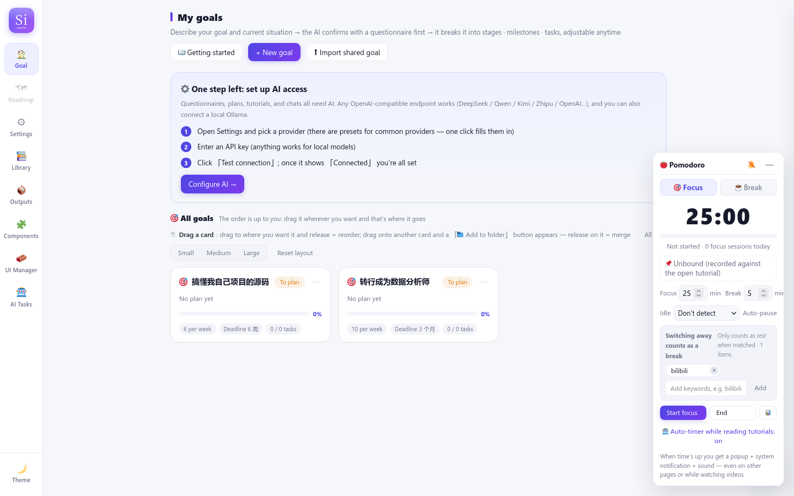
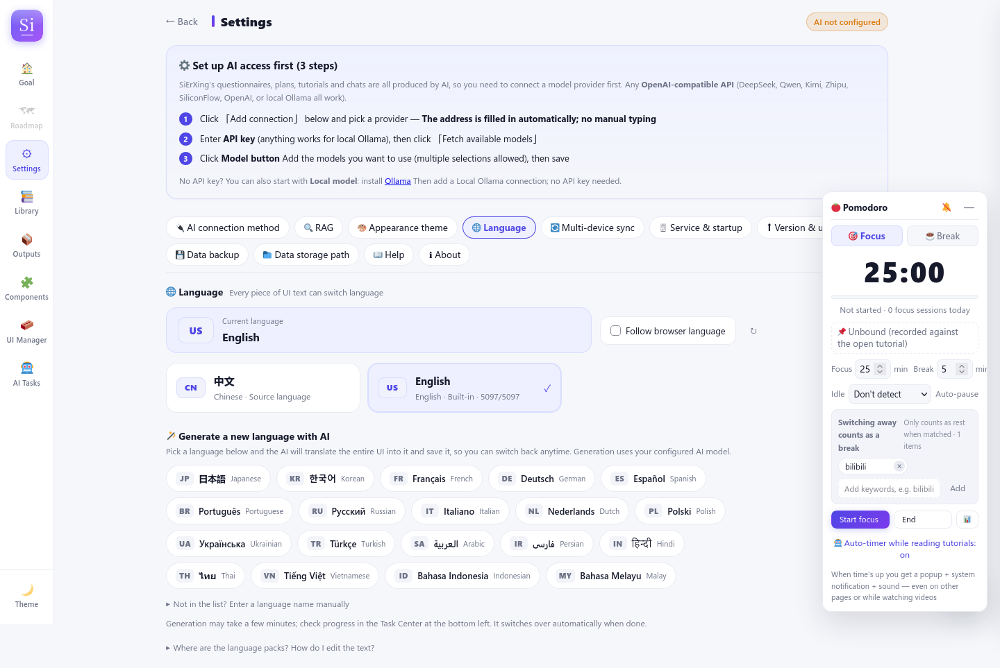
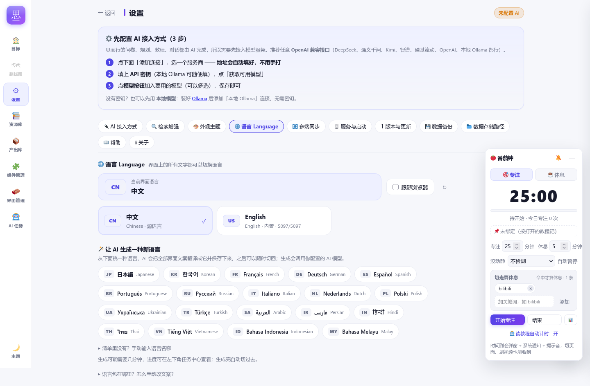

# language/ —— 思而行的语言（i18n）中心

> **一句话规则：界面上的每一个字，都必须来自这里；代码里不允许再"写死"文案。**
> 新代码用 `tr('中文原文')`，中文原文就是 key；译文放各语言包。
> 旧代码（还没迁移完的）由 `public/i18n.js` 的运行时字典层兜底，见 §4。

---

## 0. 30 秒速查（写代码前先看）

> **硬规则：代码里不允许"写死"用户可见文字；文案统一由 `language/` 管理。**
> 这条同样写在 [`AGENTS.md` §0.1](../AGENTS.md)（AI 每次改代码前必读）里。

| 你手里的东西 | 规则 | 写在哪 |
| --- | --- | --- |
| 按钮 / 标题 / 标签 / 提示 / 空状态 / toast | 用 `tr('中文原文')` | 代码里只出现源中文 key；译文进 `locales/<code>/ui.json` |
| 带变量的句子（计数、进度…） | `tr('已删除 {0} 份', n)`（占位符） | 同上；**不许** `'已删除 ' + n + ' 份'` |
| `placeholder` / `title` / `aria-label` / `alt` | 同样用 `tr()` | 同上 |
| 提示词正文 | 模板放这里 | `language/prompts/<locale>/packs.json` |
| 服务器返回、界面会显示的消息 | 写源中文短句，别自己拼长句 | 由 `npm run build:lang` 收进源目录；界面层按字典翻译 |
| 逻辑判断 / DB 值 / API 字段 / 解析标记 / 文件路径 / 测试夹具 | **不是文案**，不要 `tr()` | 留在代码里 |

**新增一条文案的标准流程（3 步）：**

```js
// 1) 代码里用 tr() 包起来（中文原文就是 key）
button.textContent = tr('开始规划');
toast(tr('已删除 {0} 份', n));
```

```bash
# 2) 收进源语言目录（同时会列出新增词条）
npm run build:lang

# 3) 补英文（或让 AI 生成其它语言）并自检
npm run check:i18n
```

**检查都不通过 = 不许合并/发布。** 守卫会检查：
源目录与代码是否同步、各语言包是否完整、占位符是否一致、英文里是否残留中文、
以及「新增硬编码预算」（`language/legacy-baseline.json` 只许降不许升）。
可选：`npm run hooks:install` 装一个 pre-commit 钩子自动跑这条检查。

---

## 1. 目录结构

```
language/
├── README.md                    ← 本文件（规则 + 操作手册）
├── index.js                     ★ 服务端语言引擎：语言列表 / 当前语言 / 语言包 / 校验 / 生成包落盘
├── extract.js                   ★ 文案提取器（build 脚本与守卫共用，纯函数）
├── source-files.js              哪些文件算"有界面文案"（build 与守卫共用同一份清单）
├── generate.js                  ★ 用 AI 生成新语言（识别语言 → 分批翻译 → 校验 → 落盘）
├── languages.json               ★ 可选语言清单（设置页从这里出「语言列表」，选中即生成，免打字）
├── locales/
│   ├── zh-CN/
│   │   ├── meta.json            语言元信息（显示名 / html lang / 文档标题与描述 / RTL）
│   │   └── ui.json              ★ 源语言目录：代码里出现过的全部界面文案（key = 原文）
│   └── en-US/
│       ├── meta.json
│       └── ui.json              中文原文 → English
├── prompts/
│   ├── README.md                提示词模板的规则
│   └── zh-CN/packs.json         可编辑提示词包模板（正文集中在这里）
└── legacy-baseline.json         「中文硬编码预算」棘轮基线（只许降，不许升）
```

> ⚠️ 打包/在线更新也要带上 `language/`：`scripts/build-exe.js` 的 `INCLUDE_DIRS` 已包含它。
> 漏掉会怎样：提示词模板加载即抛错（`server/prompts/chat-packs.js` 启动时 require），
> 而且界面语言只剩回退逻辑。新增顶层目录时记得同步这个清单。

运行时数据（**不进仓库**，升级不会覆盖）：

```
DATA_DIR/language/<code>.json    AI 生成的语言包（settings → 语言 → AI 生成界面语言）
```

---

## 2. 三种语言来源

| 来源 | 位置 | 谁维护 |
| --- | --- | --- |
| 内置：中文（源语言） | `language/locales/zh-CN/` | 代码里的中文原文 + `npm run build:lang` 自动收集 |
| 内置：英文 | `language/locales/en-US/` | 翻译稿（提交进仓库） |
| AI 生成（任意语言） | `DATA_DIR/language/<code>.json` | 用户在设置页输入语言名，AI 现翻，可删除 |

当前生效语言记在 `settings.app_language`：

- `''`（空）= **跟随浏览器**（浏览器是中文 → 中文；否则 → 英文）；
- `zh-CN` / `en-US` / 生成的语言代码 = 显式指定。
- 该设置已加入多端同步白名单（`server/sync.js` 的 `SYNC_SETTINGS`），换设备保持同一种语言。

---

## 3. 新代码怎么写文案（**强制规则**）

### 3.1 加一条界面文案

```js
/* ✅ 正确：中文原文就是 key，中文环境原样显示，其它语言自动替换 */
button.textContent = tr('保存');
toast(tr('已删除 {0} 份', n));            // 带变量：用 {0} {1} 占位符
html += `<div>${tr('还没有目标')}</div>`;

/* ❌ 错误：写死的中文（守卫脚本会失败） */
button.textContent = '保存';
```

- 变量一律用 `{0} {1} …` 占位符，不要自己拼字符串再翻译（拼接出来的句子没法翻）。
  ```js
  /* ✅ */ toast(tr('已删除 {0} 份', n));
  /* ❌ */ toast('已删除 ' + n + ' 份');   // 英文语序/量词都不同，拼接必然别扭
  ```
- 组件里也能用：`public/plugins/*.js` 直接调全局 `tr(...)`；Vue/页面插件同样可用 `window.tr`。
- `tr()` 之外的兜底：`window.SXI18N.t(...)`（同一个函数）、`window.SXI18N.setLanguage(code)`。

### 3.2 收进源语言目录

```bash
npm run build:lang          # 把新写/改过的中文收进 language/locales/zh-CN/ui.json
```

- 改了/删了已有文案也要跑一次（守卫会检查目录与代码同步）。
- 新词条出现后，英文包会缺这几条 → 补 `language/locales/en-US/ui.json`（见 §5）。

### 3.3 检查

```bash
npm run check:i18n          # 全套：目录同步 / 语言包完整性 / 占位符 / 英文残留中文 / 硬编码预算
npm run test:i18n           # 语言引擎 + 提取器 + AI 生成流程单元测试（假 AI，不花钱）
```

### 3.4 更新的 AGENTS / AI 助手规则

- 新增/修改**任何**用户可见文字（按钮、标题、提示、toast、报错、属性 placeholder/title/aria-label…）→ 必须 `tr(...)`。
- 新增提示词 → 走 `language/prompts/`（模板）或 `server/prompts/` 的 builder，不许塞回 `server.js`。
- 不要把 `tr()` 用在「逻辑判断 / 数据库值 / API 合同 / 解析标记」上 —— 那些不是文案。

---

## 4. 旧界面为什么也能切换？（过渡层，不是长期方案）

`public/app.js` 有 2000+ 条历史文案还没逐条改成 `tr()`。为了现在就能整体切语言：

1. `npm run build:lang` 静态提取出所有"可能显示的中文" → `zh-CN/ui.json`；
2. 英文包是「中文原文 → 译文」字典；
3. `public/i18n.js` 在页面渲染后（`MutationObserver`）把文本节点 / `title`、`placeholder`、
   `aria-label`、`alt` 等属性里的**中文**按字典替换。整段匹配不上时按结构逐层兜底：
   ① `{0}` 占位符模式（捕获到的变量本身也会递归翻一遍）；
   ② 标点分段（`目标列表：我的目标` → 两段分别翻）；
   ③ 剥掉 emoji/标点前后缀再试（`📖 使用引导` / `默认（内置亮色）`）；
   ④ 数字/ASCII 前缀 + 中文尾（`35 个组件`）；
   ⑤ 以标点结尾的后缀片段 / 前缀提示（`保存失败：xxx`）；
   ⑥ 只含路径/版本号的技术串里替换短的界面片段。
   每一层都只替换**目录里确实存在的片段**，用户数据（目标标题、笔记、AI 正文）不会被改写；
   原生 `confirm / alert / prompt` 也被包了一层自动翻译。
4. 不翻译的区域：AI 正文、教程正文、题面、代码等（`data-i18n-skip` 或 `class="no-i18n"`）。

这条链路是**兜底层**：新代码必须用 `tr()`；动到旧代码时优先顺手迁移。
`language/legacy-baseline.json` 记录每个文件还剩多少处写死的中文（棘轮：只许降、不许升）。

---

## 5. 补 / 改英文译文

- 文件：`language/locales/en-US/ui.json`，key 是中文原文，value 是英文。
- 占位符必须一一对应（`{0}` 不许丢、不许改数字）；`emoji` 建议保留。
- 不想手写？可以用设置页的「AI 生成界面语言」生成一份，再把结果里的词条合并进 en-US（生成包在 `DATA_DIR/language/`，是 JSON，可直接参考）。
- 批量翻译的开发辅助脚本：

```bash
node scripts/lang-batch.js split 280     # 把 zh-CN/ui.json 拆成批次（.parts/batch-NN.in.json）
node scripts/lang-batch.js check <in> <out>   # 校验一批译文（缺/多/占位符/中文残留）
node scripts/lang-batch.js merge         # 合并 .parts/*.out.json → en-US/ui.json
node scripts/lang-batch.js status        # 看进度
```

---

## 6. 用户怎么用「任意语言」

设置 → 🌐 语言：
1. **已安装语言列表**：中文 / English… 点卡片即可手动切换（旁边还有「跟随浏览器」开关）；
2. **新语言从清单选择**（`language/languages.json`，内置 20 种常见语言：日本語 / 한국어 / Français /
   Deutsch / Español / Русский / العربية…）——点一下直接开始生成，**不用用户打字**；
   清单里没有的语言，再展开「清单里没有？手动输入语言名称」自己填；
3. 生成是后台任务（进度条 + 任务中心可见）：直接采用清单里的代码/nativeName（省掉识别调用）
   → 分批翻译源语言目录 → 校验 → 落 `DATA_DIR/language/<code>.json`；
4. 完成后自动切换；之后随时可切回 / 删除。

API（内部 / Agent 也可调）：

| 方法 | 路径 | 说明 |
| --- | --- | --- |
| GET | `/api/language/state` | 当前语言 + 可用语言列表（内置/生成/词条数） |
| GET | `/api/language/pack.js?code=` | 前端字典（入口页面注入，必须在 app.js 之前加载） |
| POST | `/api/language/active` | `{code}` 切换语言（`''` = 跟随浏览器） |
| POST | `/api/language/generate` | `{name}` 启动 AI 生成任务 → `{taskId}` |
| POST | `/api/language/delete` | `{code}` 删除生成的语言包 |

---

## 7. 服务端 / 前端加载链路

```
浏览器请求 index.html
   └─ server/server.js serveStatic：
        · 按 settings.app_language（空则按 Accept-Language）确定语言
        · 重写 <html lang> / <title> / meta description
        · 注入 <script>window.__SX_I18N__=…</script>
          <script src="/api/language/pack.js?code=…"></script>
          <script src="/i18n.js"></script>
   └─ public/i18n.js：定义 window.tr / window.SXI18N + DOM 兜底翻译
   └─ sdk.js / app.js：新代码 tr()，旧代码由兜底层覆盖
```

---

## 8. 截图

英文首页 / 中英文语言设置页 / 语言列表（可选语言清单）：





更多截图见 [docs/language/screenshots/](../docs/language/screenshots/)；
截图由 `scripts/test-language-ui.js`（`SAVE_SHOTS=1`）在沙箱实例里自动生成。

## 9. FAQ

**Q：改了 `language/locales/zh-CN/ui.json` 里的 value（中文原文本身）会怎样？**
A：`tr('原文')` 的 key 是代码里的原文，改 value 不会改变 `tr('原文')` 的结果；但运行时字典层
会把界面上的「原文」替换成你改的 value —— 也就是**可以用它统一改中文措辞，而不用改代码**。
（英文用户仍按 en-US 的译文。）

**Q：为什么 `tr()` 里还要写中文？这不是"写死"吗？**
A：这是 gettext 风格：中文原文 = key + 源语言兜底。文案的**译文**全部在语言包里可调，
新增语言不需要改代码；守卫会保证所有中文都进目录。要彻底不出现中文，得用语义 key
（`app.save`），但那会让 5000 条文案的迁移和维护成本高一个量级，收益不大。

**Q：AI 生成的界面语言，AI 生成的内容（规划/教程/对话）也会变成那种语言吗？**
A：不会。当前约定是**只翻译界面**，AI 生成的内容保持模型原始输出（通常是中文/跟随你的输入）。
如果以后要「AI 内容也跟随界面语言」，在 `server/ai.js` 的 `ai.text()` 出口注入语言指令即可，
再把该指令放进语言包的 meta（这是预留的扩展点）。

**Q：语言包会不会跟着多端同步？**
A：`app_language` 设置会同步（换设备语言一致）；AI 生成的**语言包本体**在 `DATA_DIR/language/`，
不参与 Git 同步 —— 在另一台设备上可以再生成一次（或手动拷贝该 JSON 到对应数据目录）。
